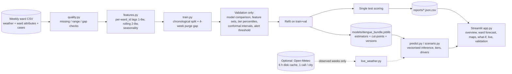

# Architecture

## 1. System and data flow

Everything left of the dotted line works **offline**. No LLM is called at any point.

**Timing convention (leakage control).** A forecast for week *t* is issued at the end of week *t* and uses only weather observed up to week *t*
(current + lags 1-8 + trailing rolls). Targets are reported cases in weeks *t+2 … t+4* (also each single week); week *t+1* is the unavoidable blind week.
Lags and rolling windows are computed with `groupby('ward_id')`, never across wards. Tests assert lag correctness, that altering future rows does not change past features,
and that the live/what-if path (`scenario.py`) reproduces batch inference exactly.

## 2. Chronological validation split
| Split | Forecast dates | Rows | Used for |
|---|---|---|---|
| Train | 2016-02 → 2022-11 | 21,180 | fitting candidates |
| Validation | 2023-01 → 2024-05 | 4,440 | **all** selection and calibration |
| Test | 2024-07 → 2025-12 | 4,500 | scored once, reporting only |

A 4-week purge gap (= longest horizon) stops target windows crossing a boundary. Every model and baseline is scored on identical rows (validation/test rows need a seasonal-naive
reference 52 weeks earlier). The deployed model is refit on train+val; calibration constants come from validation. Stability: rolling-origin CV (train before year *Y*, test *Y*, 2021-2024).

## 3. Model selection rationale
- **Candidates** (validation MAE, weeks 2-4 total): Mean 10.12 · Persistence 5.38 · Seasonal-naive 3.47 · Ridge 3.09 · ExtraTrees 2.05 · RandomForest 1.97 · HistGB 1.87 · **HistGB-Poisson 1.825** ≈ XGBoost-Poisson (tie → sklearn model kept, no extra dependency).
- **Why Poisson gradient boosting:** zero-heavy, non-negative counts; non-linear rain-lag × ward-vulnerability interactions; fast CPU training (~1.5 min) and inference.
- **Features:** weather-only (47 inputs). Adding reported-case history gave no validation gain (>3% needed) and is unavailable for new wards. Removing ward attributes hurts (MAE 2.50).
- **Forecast strategy:** direct per-horizon models vs one pooled model with a horizon feature vs window/3 (`reports/horizon_strategy_validation.csv`, validation only): mean MAE 1.006 / 1.008 / 1.101 → **direct** is used.
- **Hyper-parameters:** 12 random configs gained 0.3% (< 2% bar) → defaults kept (`reports/hpo_hgb.csv`).
- **Tiers:** Low/Medium/High/Critical = percentiles of the *training* window total (set chosen on validation by quadratic-weighted kappa; main window: Medium ≥10, High ≥27, Critical ≥41 cases). Dataset-relative, **not** official alert levels.
- **Early-warning flag:** a second, more sensitive operating point (predicted ≥ 0.65 × High cut for the main window) chosen on validation by F2 with a 10% false-alarm cap. On test it reaches recall 99% but the false-alarm rate is 19% (cap not preserved: outbreak levels shifted), so it is presented as a *watch* flag, not a tier.
- **Intervals:** 10/90% quantile GBMs + split-conformal (CQR) calibration, with a locally scaled alternative compared chronologically inside validation. Test coverage 94% (nominal 80%): conservative; per risk-level coverage in `reports/interval_calibration_test.csv`.
- **Explanations:** grouped occlusion per ward-week (what-if vs seasonal normal) + grouped permutation importance. Not causal.

## 4. Validity audit (`python -m src.audit`, validation data only)
Shuffled-target placebo R² 0.04 (no target leakage) · past-rain correlation peaks at lag 3 and exceeds future-rain correlation · ward×week climatology baseline MAE 2.59 (stronger than seasonal-naive) ·
ward attributes + season alone MAE 2.56 vs 1.83 with weather lags. R² > 0.9 and strongly autocorrelated residuals indicate **synthetic data**: results are an upper bound for the method, not real-world accuracy.

## 5. Compute and API cost controls
| Control | Where | Effect |
|---|---|---|
| Serialized model (joblib, 2.4 MB, no pandas objects, versions recorded) | `model_io.py` | no training at launch; auto-rebuild (~25 s) only if the bundle is unusable on this machine |
| Load once, compute once | `st.cache_resource`, `st.cache_data` | feature table and all-ward batch inference cached per window; ward/date changes are lookups |
| Vectorised batch inference | `predict.py` | all 31k ward-weeks scored in one call (~0.5 s); single ward-week ≈ 8 ms |
| Zero runtime API/LLM calls by default | - | $0 marginal cost, nothing to rate-limit |
| Optional live weather: **1 request per city**, `past_days=70` gives all 9 lag weeks in one call; 6 h disk cache; stale-cache fallback; `LIVE_WEATHER_OFFLINE=1` kill switch | `live_weather.py` | ≤ 5 requests per refresh, ≤ ~20/day; never fetched per ward or per rerun; failures are not memoised and never raise into the UI |
| Config via env vars (`OPEN_METEO_BASE_URL`, `OPEN_METEO_API_KEY`, `LIVE_WEATHER_CACHE_HOURS`, `LIVE_WEATHER_TIMEOUT_S`) | `live_weather.py` | no secrets in code |
| Any future LLM text summaries | not implemented | would be templated + cached per ward-tier-week with a token cap |

## 6. Geography and data provenance
No ward coordinates exist in the dataset, and its ward IDs cannot be matched to verified boundaries, so **no ward-level geographic map is drawn**. The dashboard shows (a) a ward×week risk heatmap and ranking, (b) a city-level map from
approximate city-centre coordinates, and (c) a ward-level map automatically if the team adds a verified `data/ward_coordinates.csv` (ward_id, lat, lon). Observed (CSV) weather, live recent observed/analysis weather, and user what-if scenario inputs are labelled separately everywhere; forecast weather is never fed into lag features.
